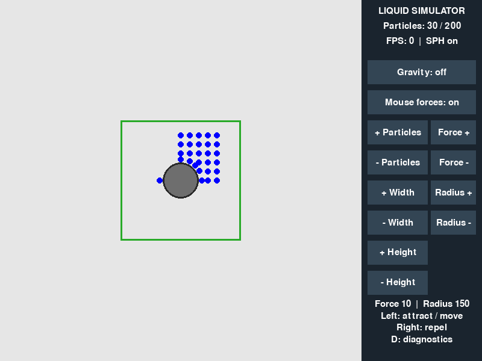

# Liquid-Simulaton

An experimental 2D particle-fluid simulator in Python and pygame. The fluid uses
smoothed particle hydrodynamics (SPH); its boundary treatment and performance
have important limitations described below and in [SPH.md](SPH.md).



## Run

Python 3.12 is the supported and CI-tested version. The only required runtime
dependency is pygame, pinned in `requirements.txt`. This version retains Python
and pygame because the existing application and its tests already use them;
replacing the renderer or language is outside this update.

```sh
python3.12 -m venv .env
.env/bin/python -m pip install -r requirements.txt
.env/bin/python Graphics.py
```

## Controls

- Drag with the left mouse button to attract particles; drag with the right to
  repel them. The influence ring shows the current radius. The mouse-force toggle
  affects these gestures, not the SPH fluid solver, which remains on.
- Left-drag the circular obstacle itself to move it within the container. The
  kinematic obstacle displaces particles but does not impart a velocity impulse.
- Toggle gravity, add or remove particles, and adjust the container dimensions
  from the side panel. Hold a particle button to repeat: the first change is
  immediate, followed by a 0.4-second delay and a smoothly accelerating repeat.
  The interactive controls allow 0–200 particles; the model and tests do not
  impose the UI cap.
- Adjust mouse force and radius with the side-panel buttons. Press `D` to toggle
  influence-disc and velocity diagnostics. The container outline, obstacle,
  particles and mouse ring remain visible in the normal view.

## Physics and performance

The simulation advances in fixed 1/120-second physics steps, with at most eight
steps per frame. Excess elapsed time is dropped, so simulation time can lag
behind wall-clock time under load. Force, speed and timestep guards protect
against runaway values; they are not proof of physical accuracy.

The circular and planar walls use approximate reflected SPH samples plus
collision projection. Dynamic and static wall tests cover the cases documented
in [SPH.md](SPH.md), not every fluid or obstacle configuration. Mouse-force
values use the original 120 Hz reference-rate convention; SPH and gravity are
converted to that channel once.

A fresh headless full-application run on macOS 15.8.3 (Intel i9-9880H), Python
3.12.0 and pygame 2.5.2 used 200 particles, gravity and SPH, a 200 × 200 box,
a radius-30 obstacle, 300 warmup steps and an 8-second sample at a 30 Hz cap.
It produced 38 measured frames: mean 210.93 ms, median 210.89 ms, p95 237.88 ms,
maximum 238.38 ms, and 7.95 physics steps per frame. It dropped 5.28 seconds of
simulation time, recorded densities 0.00220–0.06822 and maximum speed 54.21 px/s,
and activated no guards. The 33.33 ms frame budget was **not met**. This is one
machine and one workload, not a universal frame rate; further optimization and
the 3D/Rust rewrite are deferred to v3.0.

A separate physics-only 60-second qualification ran 7,200 steps, remained
finite, had no obstacle penetration or guard activations, and measured maximum
speed 42.73 px/s and density 0.3183–2.4598 times rest density. It is not an
application frame-rate test or a general physical-accuracy certification.

## Tests and contribution

```sh
SDL_VIDEODRIVER=dummy SDL_AUDIODRIVER=dummy .env/bin/python -m unittest discover -s tests -v
.env/bin/python -m ruff check .
SDL_VIDEODRIVER=dummy SDL_AUDIODRIVER=dummy .env/bin/python scripts/qualify_sph.py --seconds 60
```

Ruff 0.17.5 is the CI lint tool and is installed separately, not as a runtime
dependency. See [CONTRIBUTING.md](CONTRIBUTING.md) and [SPH.md](SPH.md) for
the contribution process, equations, qualification and limitations.

## References and licence

- [Smoothed-particle hydrodynamics](https://en.wikipedia.org/wiki/Smoothed-particle_hydrodynamics)
- [Coding Adventure: Simulating Fluids — Sebastian Lague](https://youtu.be/rSKMYc1CQHE)

Lucas Goddin. Contributions are accepted under the [MIT licence](LICENSE).
